# KhataApka

A simple khata (ledger) and billing app for a small kids-wear shop that is run by one person.

The owner does the selling, the collection of payments and the deliveries all by himself, so the app is built around that: quick entries, a clear cash view, and a list of who still owes money. It runs fully on the phone, works offline, and is available in four languages.

> Built for a real shop. There is deliberately **no stock/inventory section**, because the stock changes with whatever is trending and selling.

**Download:** the latest APK is on the [Releases page](https://github.com/Kirio02/Khata-F-public/releases/latest). If you already have the app, install the new APK over it; your data stays.

## What's new in 1.3

- **Edit photos:** crop, rotate or write on a photo with your finger, right after taking it or later from the photo viewer.
- **PDF language:** pick English, Hinglish, Hindi, Gujlish (Gujarati words in English letters) or Gujarati for statements and bills. *Debit / Credit* become *Udhar / Jama*.
- **Tap a photo in the statement PDF** to jump to the full photo, and "Back to entry" to return. It all stays inside the PDF: no upload, no internet.
- **WhatsApp remind:** choose to send a short text or the full statement PDF. The text statement now uses the same language as the PDF.
- **Challan number in quick entry**, and older entries whose note was just a number (like "852") now show it as "CH. NO. 852".
- The Vasuli list on the home screen folds up to save space.
- The English labels now say "You Gave (Udhar)" and "You Got (Jama)".

## What's new in 1.2

- **Challan number** on khata entries, shown as "CH. NO. 985". A *Challan / Note / Both* switch picks which boxes the entry form shows.
- **Phone-friendly PDFs.** Statements and bills come in a *Mobile* size that reads on WhatsApp without zooming, or *A4* for printing. Pick the header colour and white or cream paper in **More > PDF ka Design**.
- **Photos in the statement:** a numbered thumbnail beside each entry and the full photo at the end.
- **Background colour:** White, Cream, Dark, or follow the phone (System).
- **Pick any date** with a calendar when adding a bill, khata entry or cash entry.
- **Delete a party**, and an "are you sure?" step before deleting an entry.
- Layouts fixed for narrow phones with large text, and the contact import screen survives rotation.
- Safer money handling: payments are sized from the saved data, and the balance import (CSV) never guesses an amount.

## Features

**Khata (party ledger)**
- Add customers and suppliers, or import them from phone contacts (duplicates are skipped).
- "I Gave" / "I Got" entries with a running balance per party, on any date picked from a calendar.
- An optional challan number on each entry ("CH. NO. 985"), a note, or both.
- Payments are matched to the oldest unpaid bills first, so each bill shows what is still pending.
- Vasuli list: who owes money, and who is actually overdue (past the due date, or older than 15 days). It folds up when not needed.
- Send a reminder on WhatsApp as a short text or the full statement PDF, or SMS or call. Invalid phone numbers are flagged.
- Delete an entry or a whole party, always after a confirmation that shows the amounts involved.
- Move balances over from another khata app with a simple CSV file (name, phone, balance). Rows that can't be read exactly are shown and skipped, never guessed.

**Billing**
- Create bills with GST details, discounts, delivery/packaging charges and a UPI QR code on the bill.
- Several bill designs, PDF invoices, and sharing the PDF in one tap.

**PDF statements and bills**
- Mobile size (phone-width pages, large text) or A4 for printing.
- Four header colours and white or cream paper, with a live preview.
- Words in English, Hinglish, Hindi, Gujlish or Gujarati (Udhar / Jama instead of Debit / Credit).
- Balance due at the top, then one clear block per entry with the challan number.
- A small photo icon on entries with photos; tap it to open the full photo inside the PDF.
- Past bills, cancellation, and "Mark received" for part or full payment.

**Cashbook**
- A large "cash in shop now" number, with today's money in and money out.
- Separate Cash and Bank books and a deleted-entries bin.

**Daily work for one person**
- "Aaj ki delivery": a quick list of today's deliveries.
- A daily report notification at 8:30 PM.
- Reports for the accountant (CSV and summaries).

**Voice entry**
- Speak an entry, such as "Suresh ne 5 thousand diye". The app checks who and which direction before saving.

**Safety**
- App lock with PIN and fingerprint, and an option to block screenshots.
- Backup and restore as a zip file.
- Crop, rotate or write on entry photos.
- If the app ever crashes, the next start shows the error with a Share button.

**Look**
- White, Cream, Dark or System background, chosen in More.
- Works on narrow phones with large text and 3-button navigation.

**Languages:** Hinglish, Hindi, Gujarati and English.

## Screenshots

| Home | Parties | Customer ledger |
|---|---|---|
| 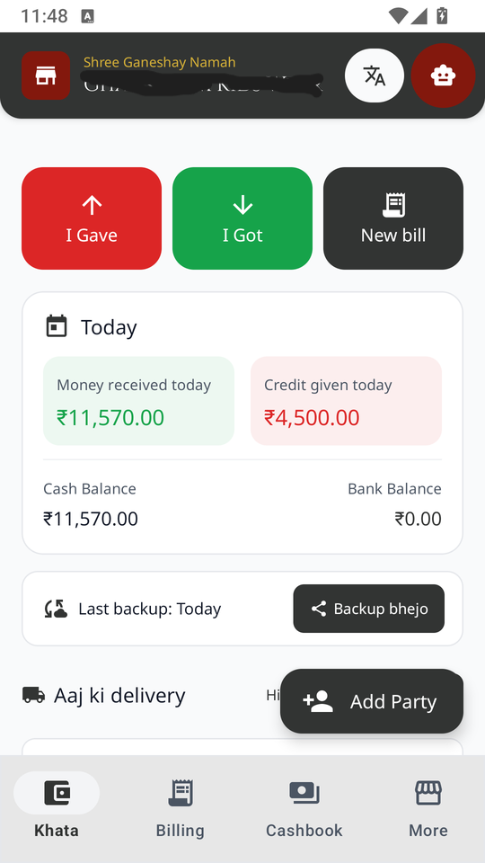 | 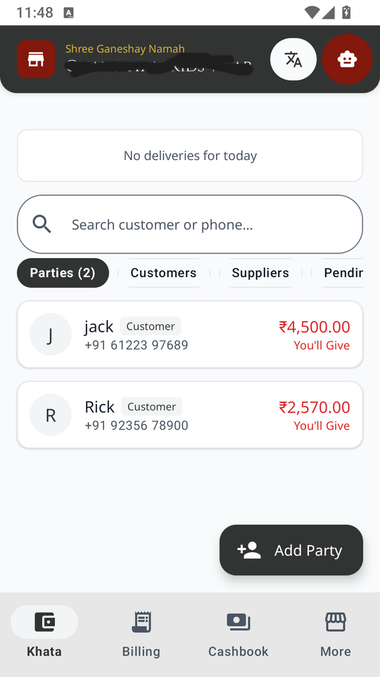 | 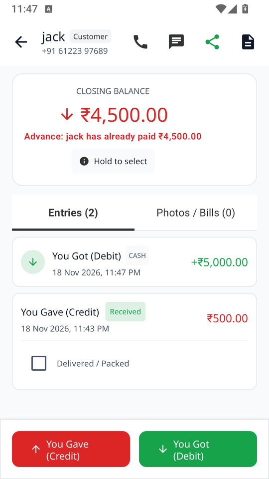 |

| Quick entry | Past bills | Cashbook |
|---|---|---|
| 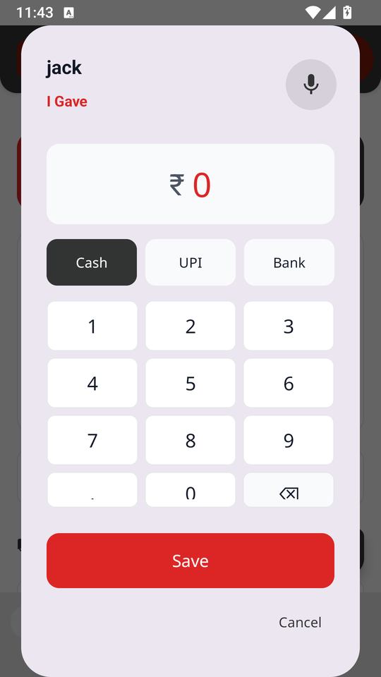 | 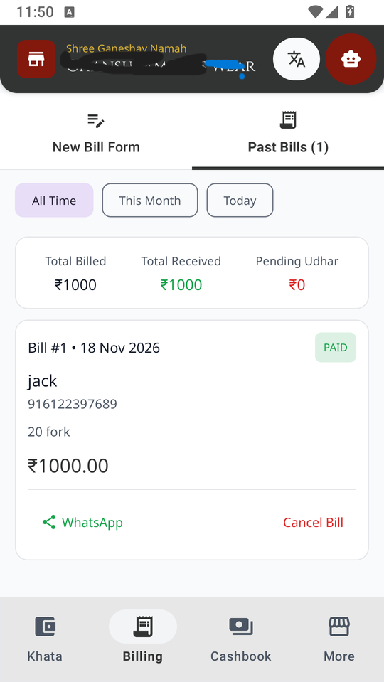 | 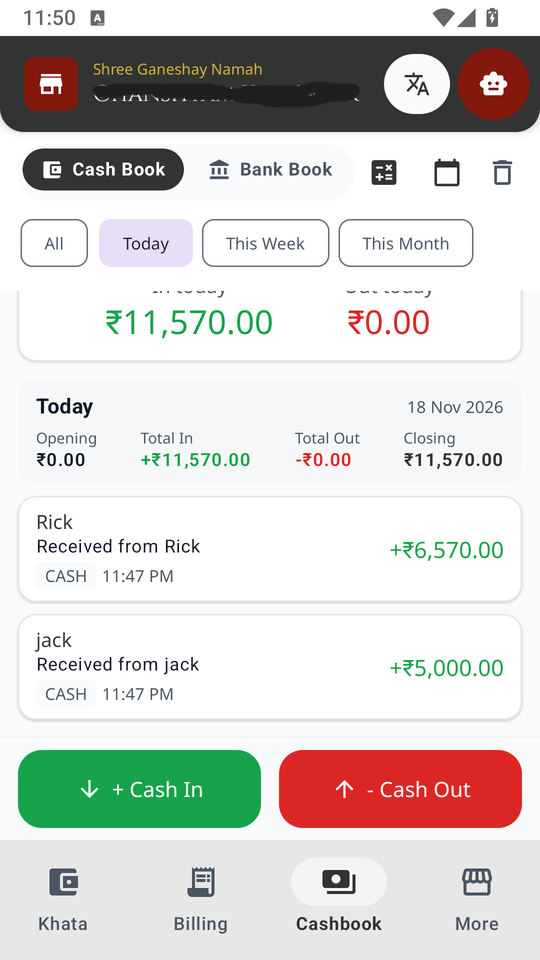 |

| Challan or note | Ledger with challan | Statement PDF (Mobile) |
|---|---|---|
| 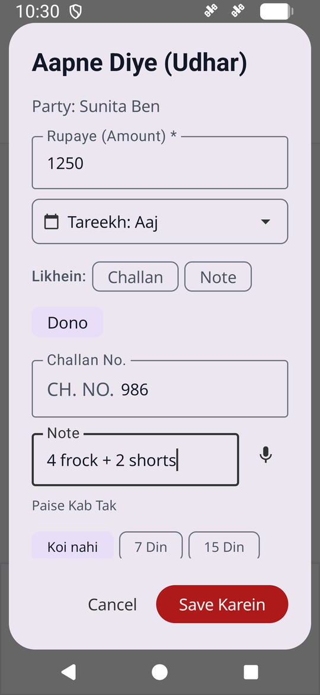 | 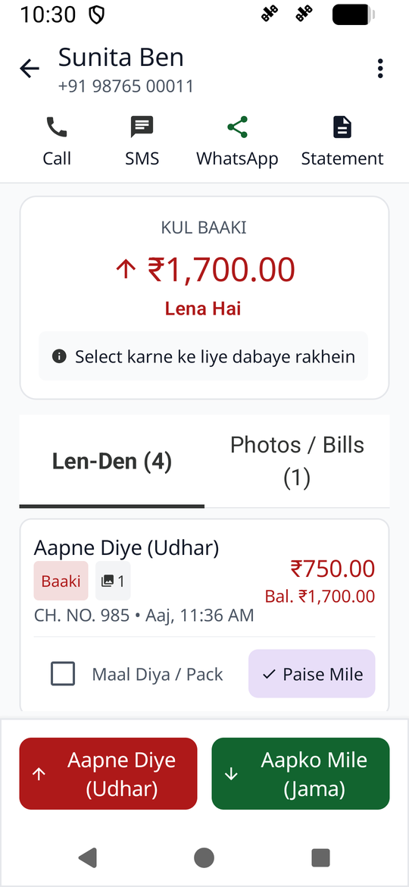 | 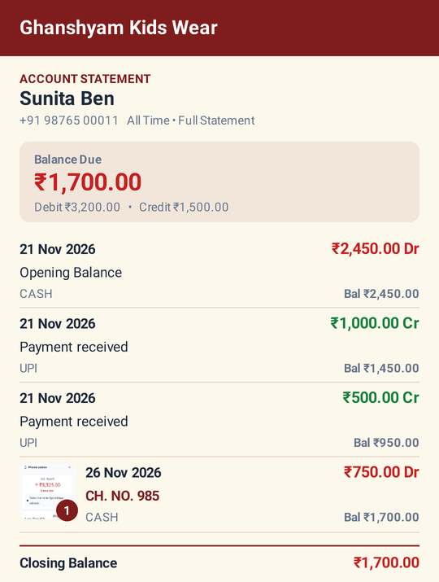 |

| PDF design | Dark background |
|---|---|
| 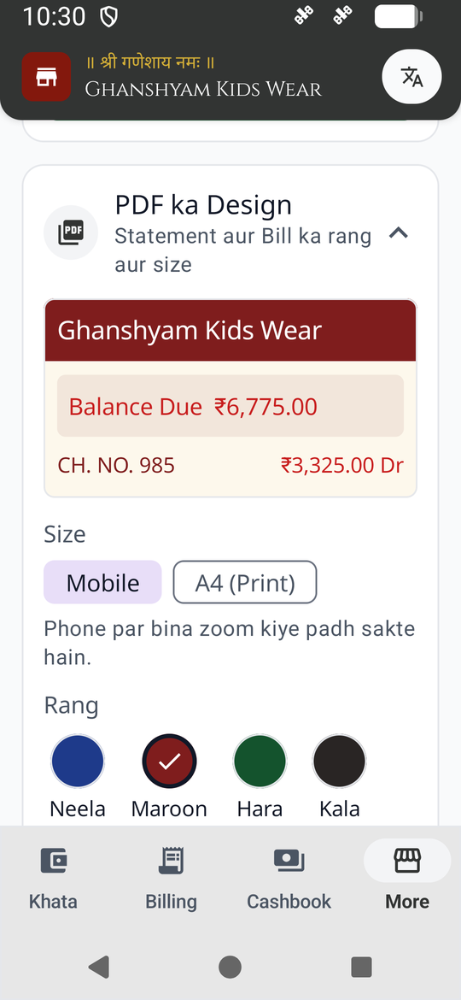 | 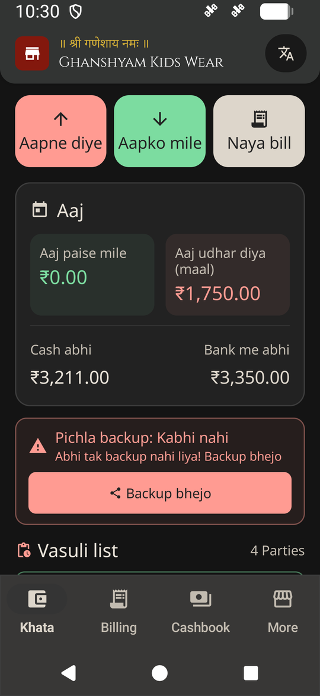 |

_Names and phone numbers shown are test data._

## Privacy

- All shop data is stored on the phone. There is no account and no server.
- The app does not use the internet at all.

## Tech

Kotlin, Jetpack Compose (Material 3), Room database, WorkManager, encrypted preferences and biometric lock.
Android 8.0+ (minSdk 26). Built with JDK 21 and Gradle.

## Build it yourself

1. Install JDK 21 and Android Studio (or the Android SDK).
2. Create a debug signing key in the project root. Never commit it; it is ignored by `.gitignore`.

   ```
   keytool -genkeypair -v -keystore debug.keystore -storepass android -keypass android -alias androiddebugkey -keyalg RSA -keysize 2048 -validity 10000 -dname "CN=Android Debug,O=Android,C=US"
   ```

3. Generate the Gradle wrapper and build:

   ```
   gradle wrapper
   ./gradlew assembleDebug
   ```

   The APK is in `app/build/outputs/apk/debug/`.

4. Run the tests with `./gradlew testDebugUnitTest`.

The GitHub Actions workflow in `.github/workflows/main.yml` does the same on every push. It reads the signing key from a repository secret named `DEBUG_KEYSTORE_BASE64`.

## Status

Used and improved in a real shop, one fix at a time. Bug reports and ideas are welcome as issues.

## License

No license has been chosen yet. Until one is added, all rights are reserved by the author.
